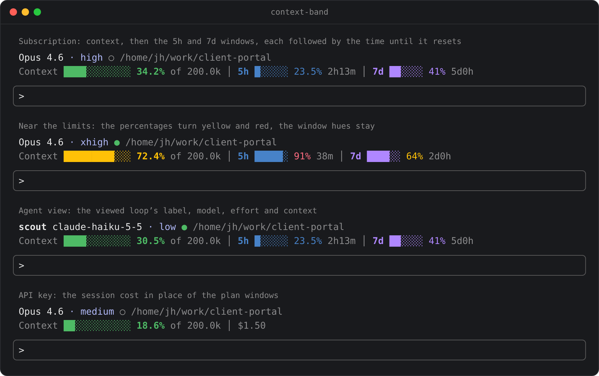
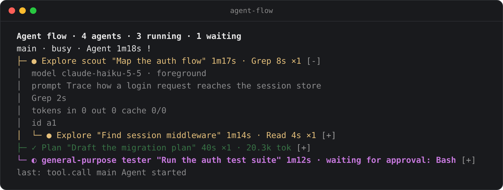

# claude-mods

[English](README.md) | [中文](README.zh-CN.md)

A curated Claude Code marketplace hosting **mods** — plugins whose code registers event handlers. One repository hosts them all; install by mod name.

A mod is a Claude Code plugin whose JavaScript or TypeScript code registers handlers that Claude Code calls as events happen. See the [mods overview](https://code.claude.com/docs/en/plugins/mods/overview).

The catalog lists every mod in this marketplace; each entry installs from here.

| mod | description | install |
| --- | --- | --- |
| [context-band](mods/context-band/README.md) | Read-only band above the prompt: model and effort, context fill, and the 5h / 7d plan windows in their own colours with their own reset times, or the session cost | `/plugin install context-band --marketplace JinhaoFang/claude-mods` |
| [block-destructive-commands](mods/block-destructive-commands/README.md) | Denies destructive Bash commands (recursive rm on roots, force push, hard reset, destructive SQL, disk formatting) before they run | `/plugin install block-destructive-commands --marketplace JinhaoFang/claude-mods` |
| [agent-flow](mods/agent-flow/README.md) | Live tree of the session's subagents and teammates in a pane beside the transcript; prints as text where no pane can be drawn | `/plugin install agent-flow --marketplace JinhaoFang/claude-mods` |
| [image-view](mods/image-view/README.md) | Previews images above the prompt (pasted, or a path you type or drop) and under the tool call that read them; pictures in kitty and Ghostty, a link to open the file in any other terminal | `/plugin install image-view --marketplace JinhaoFang/claude-mods` |
| [redact](mods/redact/README.md) | Rewrites sensitive data (emails, IPs, credentials, addresses, phone numbers) into placeholders before it enters the model context; precision-first rules leave DOIs, hashes and version numbers alone | `/plugin install redact --marketplace JinhaoFang/claude-mods` |

## Previews

Mods that draw something get a picture here; mods that only act on events (block-destructive-commands, redact) have nothing to show.

### context-band

The band in four states, drawn from the mod's own output:



### agent-flow

The pane's rows for a session with four subagents, drawn from the mod's own output:



### image-view

The band where the terminal draws no pictures, such as the VS Code terminal: each image is a line whose name opens the file. In kitty and Ghostty, PNGs are drawn as pictures instead:

```
[Image #1]  1280×720
shots/login.png  640×480
❯ why does the header differ between [Image #1] and shots/login.png
```

## Install

Mods load only on Claude Code v2.1.287 or later. The one-line form adds the marketplace and installs the plugin together:

```
/plugin install context-band --marketplace JinhaoFang/claude-mods
```

Or add the marketplace once, then install any mod by name:

```
/plugin marketplace add JinhaoFang/claude-mods
/plugin install context-band@claude-mods
```

Type the commands in a Claude Code terminal session, confirm with `y`, and pick the user scope — the mod goes live in the current session.

## Contributing

To propose a mod, see [CONTRIBUTING.md](CONTRIBUTING.md).

## License

Apache-2.0, see [LICENSE](LICENSE).
