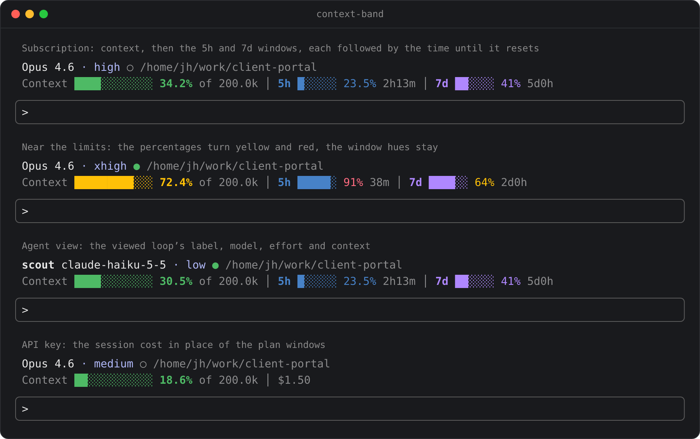

# context-band

[English](README.md) | [中文](README.zh-CN.md)

A Claude Code mod: a read-only band above the prompt. The top row shows the model, its effort and the session directory. The bottom row shows the context gauge and the plan quota or the session cost. The band follows whichever conversation is on screen: the main conversation, or one agent loop's transcript opened from the tasks list.

## Install

From the GitHub marketplace (type in a Claude Code terminal session):

```
/plugin install context-band --marketplace JinhaoFang/claude-mods
```

or from a local folder:

```
/plugin install context-band --marketplace /path/to/mods/context-band
```

Answer `y` to add the marketplace and pick the user scope. The band goes live in the current session.

## The band



```
Opus 4.6 · high ○ /home/jh/work/client-portal
Context ████░░░░░░░░ 34.2% of 200.0k │ 5h █░░░░░ 23.5% 2h13m │ 7d ██░░░░ 41% 5d0h
```

- **Environment row**: the model name; the effort level on its own (`high`), shown once the first turn has reported one; a working dot (`●` running, `○` idle); then the session directory in dim colour. In an agent view the row starts with the viewed loop's label and shows that loop's model and effort.
- **Readings row**: the context gauge, then each plan window under its own label, `5h` and `7d`, with the time until that window resets (`2h13m`, dim) right after its own percentage.

The band has no buttons: it only shows readings. It draws only block elements, box-drawing lines and plain text. Arrow glyphs such as `↺` often fall back to a font wider than one cell and overprint the next character, so the band uses none.

### The context gauge

- The percentage measures the **compaction window**, where auto-compact fires, which is below the model's theoretical limit. Read it as "how much conversation is left".
- Colour thresholds default to green below 60%, yellow from 60% to 85%, and red from 85%. Change them in `/config`.

### Plan quota and cost

The band checks what the engine reports, not the login method. When the engine reports subscription windows, the band draws the two labelled quota gauges. When it reports none, the band shows this session's cost instead, with a gateway's spend limit appended when one is reported.

### Colours

Each reading has a hue of its own, so the three never look alike:

| reading | colour |
| --- | --- |
| Context | green, turning yellow and then red past the thresholds |
| 5h window | blue (theme key `ide`) for its label and bar |
| 7d window | violet (theme key `autoAccept`) for its label and bar |

Past the thresholds only a window's percentage turns yellow or red; its label and bar keep their hue, so the two windows stay apart even when both run high. Any reading above zero fills at least one cell, so 8% never looks like an empty bar.

### Narrow terminals

When the readings row is wider than the terminal, it gives way in this order: the bars shrink, then `of 200.0k` goes, then the bars go. The numbers, the labels and the reset times always stay. On the environment row the directory gives way first: the last two segments while they fit, then the last one.

## Agent views

Open one agent loop's transcript from the tasks list and the band follows the view:

- The gauge shows that loop's own context fill. Its label is the loop's name, else its agent type, else a short id.
- Its model and effort replace the main conversation's, and the working dot follows that loop's status.
- The plan quota and the cost stay on the readings row, since they are account-level readings.
- A loop with no completed step yet shows a dim `0.0%` and no model.
- The main conversation keeps the engine's native readings throughout. [ADR-0004](../../docs/adr/0004-agent-view-context-from-turn-steps.md) records where the per-agent figures come from.

## Configuration

Rows named `context-band.*` in `/config`:

| option | default | description |
| --- | --- | --- |
| `warningThreshold` | 60 | Percent where colours turn to warning |
| `errorThreshold` | 85 | Percent where colours turn to error |
| `refreshSeconds` | 7 | Fallback redraw interval; each turn end updates the band at once |

## Data source

The main conversation's figures come from the engine-native `$.session.usage()`, a free local call. Each turn end pushes a redraw, and a fallback clock redraws every `refreshSeconds` so the reset times keep moving. An agent view's figures come from that loop's completed `turn.step` requests, because the engine has no per-agent usage call. The mod spawns no subprocesses and makes no network requests. The cost shown is what **this session** has spent; account-level totals are not reachable through the plugin API.

Uninstall: `claude plugin uninstall context-band`

## Development

Contributor rules, including the mod contract and the inclusion bar, live in [`CONTRIBUTING.md`](../../CONTRIBUTING.md).

```bash
claude plugin validate mods/context-band
claude plugin test mods/context-band
```

## License

Apache-2.0, under the repository's root [LICENSE](../../LICENSE).
