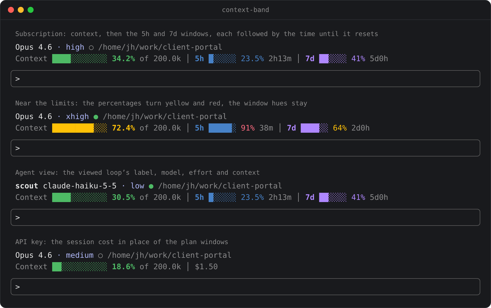

# context-band

[English](README.md) | [中文](README.zh-CN.md)

Claude Code 的一个 mod：输入框上方的一条只读信息带。上面一行是模型、思考强度和会话目录，下面一行是上下文用量，以及套餐额度或本会话费用。信息带跟随屏幕上正在显示的会话：主会话，或从任务列表打开的某个 agent loop 的转录。

## 安装

从 GitHub marketplace 安装（在 Claude Code 终端会话中输入）：

```
/plugin install context-band --marketplace JinhaoFang/claude-mods
```

或从本地文件夹安装：

```
/plugin install context-band --marketplace /path/to/mods/context-band
```

按提示输入 `y` 添加 marketplace，选择 user scope，当前会话立即生效。

## 信息带的样子



```
Opus 4.6 · high ○ /home/jh/work/client-portal
Context ████░░░░░░░░ 34.2% of 200.0k │ 5h █░░░░░ 23.5% 2h13m │ 7d ██░░░░ 41% 5d0h
```

- **环境行**：模型名；思考强度直接显示级别（`high`），第一轮对话上报后才出现；工作状态点（`●` 运行中，`○` 空闲）；最后是暗色的会话目录。在代理视图中，行首是该 loop 的标签，模型和思考强度也换成那个 loop 的。
- **读数行**：上下文量表，然后是两个套餐窗口，各自带 `5h`、`7d` 标签，每个窗口距离重置的剩余时间（暗色的 `2h13m`）紧跟在它自己的百分比后面。

信息带没有任何按钮，只负责显示读数。它只使用方块字符、制表线和普通文字。`↺` 这类箭头符号常常回退到比一格更宽的字体，会压住后面的字符，所以一律不用。

### 上下文量表

- 百分比按 **compaction 窗口**计算。自动压缩在这个窗口触发，它比模型的理论上限小，所以这个数字可以理解为"还能聊多少"。
- 颜色阈值默认：低于 60% 绿色，60% 到 85% 黄色，85% 及以上红色。可在 `/config` 中调整。

### 套餐额度与费用

信息带看引擎上报了什么，而不是看登录方式。引擎上报订阅窗口时，画出两个带标签的额度条；没有上报时，改为显示本会话费用，网关上报了花费上限时，在后面附加一条上限额度条。

### 颜色

每项读数有自己的颜色，三者不会混淆：

| 读数 | 颜色 |
| --- | --- |
| Context | 绿色，超过阈值依次变黄、变红 |
| 5h 窗口 | 标签和进度条为蓝色（主题键 `ide`） |
| 7d 窗口 | 标签和进度条为紫色（主题键 `autoAccept`） |

超过阈值时，只有窗口的百分比变黄或变红，标签和进度条保持原色，所以即使两个窗口都很高也能区分。任何大于零的读数至少填满一格，8% 不会显示成空进度条。

### 窄终端

读数行比终端宽时，按这个顺序让位：先缩短进度条，再去掉 `of 200.0k`，最后去掉进度条。数字、标签和重置时间始终保留。环境行里目录先让位：放得下时保留最后两段，否则只留最后一段。

## 代理视图

从任务列表打开某个 agent loop 的转录，信息带随之切换：

- 量表显示该 loop 自己的上下文用量。标签依次取 loop 的名字、agent 类型、短 id。
- 模型和思考强度换成该 loop 的，工作状态点也跟随该 loop。
- 套餐额度和费用属于账户级读数，继续留在读数行。
- 还没完成任何一步的 loop 显示暗色的 `0.0%`，不显示模型。
- 主会话始终使用引擎原生读数。每个 agent 的数据从哪里来，记录在 [ADR-0004](../../docs/adr/0004-agent-view-context-from-turn-steps.md)。

## 配置

在 `/config` 中名为 `context-band.*` 的行：

| 选项 | 默认 | 说明 |
| --- | --- | --- |
| `warningThreshold` | 60 | 颜色变为警告色的百分比 |
| `errorThreshold` | 85 | 颜色变为错误色的百分比 |
| `refreshSeconds` | 7 | 兜底重绘间隔（秒）；每轮对话结束会立即更新 |

## 数据来源

主会话的数据来自引擎原生的 `$.session.usage()`，这是一次免费的本地调用。每轮对话结束时触发一次重绘，兜底时钟每隔 `refreshSeconds` 秒重绘一次，让重置时间保持更新。代理视图的数据来自该 loop 已完成的 `turn.step` 请求，因为引擎没有按 agent 查询用量的接口。本 mod 不启动子进程，也不发起网络请求。显示的费用是**本会话**的花费；插件 API 拿不到账户级总额。

卸载：`claude plugin uninstall context-band`

## 开发

贡献规则（mod contract 与 inclusion bar）见 [`CONTRIBUTING.md`](../../CONTRIBUTING.md)。

```bash
claude plugin validate mods/context-band
claude plugin test mods/context-band
```

## 许可证

Apache-2.0，见仓库根目录的 [LICENSE](../../LICENSE)。
